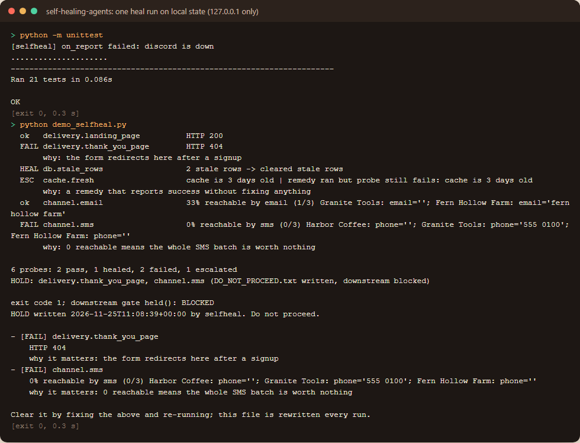

# self-healing-agents

[](https://github.com/chasebuilds/self-healing-agents/actions/workflows/ci.yml)  

Health checks that ask whether unattended work is still worth anything, not just whether it crashed.

## See it run

These probes watch real unattended jobs, so there is nothing to click in a browser. Below are the 21 tests, then [`demo_selfheal.py`](demo_selfheal.py): one heal run against made-up local state, a throwaway web server on 127.0.0.1, an in-memory SQLite table and three invented contacts. Nothing is sent anywhere. Captured from the terminal unedited ([full transcript](docs/run.txt)).



What to look for:

- `db.stale_rows` fails, its remedy runs, the probe is run again and passes: `HEAL`.
- `cache.fresh` has a remedy that says it worked but changes nothing. The re-check catches it: `ESC`, not `HEAL`.
- `channel.sms` finds 0 of 3 contacts reachable by text. Nothing crashed, but the batch is worth nothing, so it is critical and writes the hold marker that downstream steps check with `held()`.
- The `on_report failed: discord is down` line comes from a test that checks a broken notifier cannot fail the run.

### Run it yourself in 3 commands

Python 3.11 or newer, no packages to install:

```
git clone https://github.com/chasebuilds/self-healing-agents && cd self-healing-agents
python -m unittest
python demo_selfheal.py
```

## The idea

An ordinary health check asks: **did anything crash?**

These probes ask the harder question: **is what we built still able to reach a human, and is what we are about to spend still worth spending?**

Every expensive failure in the system this was extracted from answered YES to "nothing crashed" and NO to "it was worth anything". Exit codes were zero, unit tests passed, dashboards were green, and the output had no value. That is the whole class of defect this library exists to catch.

The loop is four steps, not one:

```
probe -> bounded remedy -> RE-VERIFY by re-running the probe -> record the lesson
```

Detection alone is a monitoring tool. Detection plus an unverified repair is worse than detection, because now you believe it is fixed.

## Why ordinary health checks miss this

Most checks are written against the failure modes you have already seen crash. They watch the process, not the product.

- A pipeline can produce a perfectly correct artifact whose delivery channel cannot terminate at a human. Nothing throws.
- A verifier can prove the artifact is internally consistent and never ask whether the thing it points at exists.
- A degraded path can be the designed fallback. Losing the model and silently scoring on keywords alone is a successful run by every process-level metric.
- A job that stops running looks exactly like a job with nothing to report, and every dashboard stays green, because the dashboards are written by the thing that stopped.
- A rule you rely on but never check is a wish. Sometimes the code was never written at all.

None of these are crashes. All of them cost real time or real money.

## War stories

Each one is measured, from the private system this was extracted from.

| What looked fine | What was actually true |
|---|---|
| A cold-outreach venture ran clean and produced 160 qualified leads. | 0 of 160 were emailable **by construction**: the qualifier selected businesses with *no website*, and the only email-derivation strategy derived `info@<website>` **from** the website. Found by hand, one purchase decision away from being found the expensive way. |
| 22 physical postcards staged with QR codes; the verifier passed all 22 for 8 days. | The QR codes pointed at a domain that was never bought. The verifier proved the QR *decoded* to the expected URL, and never that the URL *resolved*. |
| A local LLM returned answers; the caller retried on bad ones like it was designed to. | The model's own "thinking" ate its token ceiling, so 46% of generations came back truncated mid-JSON. Truncation reads as a bad answer, so all 3 retries burned against the same wall. Raising the ceiling took it to 0%. |
| A background video pipeline rendered and published for 4 days with no errors. | It jump-cut between 21 unrelated clips per video. Invisible because one footage category looked uniform everywhere, so four days of reports read a rendering bug as an asset-tagging problem. |
| Engineering notes recorded a permanent safety guard as shipped. | It had never been written. This is the entire reason every remedy must be re-verified by re-running its own probe: a fix nobody re-checked is a hope, not a fix. |
| Six consecutive days of green dashboards and zero alarms. | Nothing ran for six days. Nothing alarmed, because the thing that writes the alarms is the thing that stopped. Found by a human noticing an absence. |

The pattern underneath all six: **a correct artifact with no reachable destination, or a loop that stopped without anyone being told.**

## Design rules

Each of these was paid for by one of the failures above.

1. **Every remedy is re-verified by re-running its own probe.** A remedy that reports success while the probe still fails is an `ESCALATE`, never a `HEAL`.
2. **Two failed remedies stop the loop.** Self-healing that keeps retrying is a crash loop with better branding. The third attempt is the definition of one.
3. **`auto=True` is opt-in per probe, and nothing that arms an outbound path ever gets it.** By construction, not by config. Some probes exist only to alarm.
4. **A CRITICAL failure writes a hold marker that downstream steps refuse to cross**, so "broken" costs nothing instead of costing postage.
5. **Every probe carries a `why` that says what breaks in the real world.** A probe whose message does not is a probe someone mutes, and a muted probe is worse than no probe.
6. **Verify by artifact the job wrote itself, not by the scheduler's opinion.** A scheduler that believes it launched something proves nothing; a heartbeat written at the *end* of a run proves the code finished.
7. **A probe that fails every run on a condition nobody intends to fix gets muted, taking the useful probes with it.** Name known-quiet exceptions explicitly, with the measurement that justifies them, and delete the entry when it revives.
8. **Report, do not auto-tune.** Surface the distribution and leave the judgement call to a human. Auto-tuning a threshold on a dry spell posts exactly the junk the threshold was built to keep out.
9. **A probe that raises is itself a finding**, not a reason for the run to die.
10. **Repair the specific artifact from the record; do not re-run the producing step.** Re-running the producer usually operates on the newest input, not the broken one, and quietly creates a second problem.

## Usage

A probe is a function returning `(ok: bool, detail: str)`. That is the entire contract.

```python
from selfheal import Probe, run, held, WARN, CRITICAL
import reachability

VENTURE_DIR = "."


def check_landing_page():
    """The artifact is only worth something if its destination resolves."""
    return reachability.http_ok("https://example.com/offer/abc")


def check_channel_coverage(conn):
    """pct == 0 on a non-empty population is a contradiction between the
    qualifier and the channel, not a bug in any one record."""
    cov = reachability.channel_coverage(conn, "email")
    if cov["total"] and cov["pct"] == 0:
        return False, "0 of %d records are emailable: %s" % (
            cov["total"], "; ".join(cov["examples"]))
    return True, "%.0f%% reachable (%d/%d)" % (
        cov["pct"], cov["reachable"], cov["total"])


def check_stale_rows(conn):
    n = conn.execute("SELECT COUNT(*) FROM attempts WHERE status='stale'").fetchone()[0]
    return (n == 0), "%d stale rows" % n


def repair_stale_rows(conn):
    conn.execute("DELETE FROM attempts WHERE status='stale'")
    conn.commit()
    return True, "cleared stale rows"


probes = [
    Probe("delivery.landing_page", check_landing_page, severity=CRITICAL,
          why="every staged piece carries a QR to this URL; if it does not "
              "resolve, mailing them buys postage to send people to a dead host"),

    Probe("channel.coverage", lambda: check_channel_coverage(conn), severity=CRITICAL,
          why="an unreachable population means the whole batch is worth zero, "
              "and nothing about it looks broken"),

    # Opt-in repair: safe because a duplicate here is always a bug, never data.
    Probe("db.stale_rows", lambda: check_stale_rows(conn),
          remedy=lambda: repair_stale_rows(conn), auto=True, severity=WARN,
          why="stale rows silently multiply every count in the status page"),
]

report = run(probes, name="outreach", root="./state", on_report=notify)
raise SystemExit(report["exit"])   # 0 = clean or fully healed, 1 = needs a human
```

Downstream steps gate on the hold marker rather than trusting that the heal run happened:

```python
if held(VENTURE_DIR):
    sys.exit("dispatch held; fix the probes and re-run")
```

`run()` returns a report containing per-probe status (`PASS`, `HEALED`, `FAIL`, `ESCALATE`), the names of anything `blocking`, and an exit code. It also appends every result to an append-only history file, which is the input to the question that matters over months: **which invariants keep breaking?** A probe that keeps failing is a design defect asking to be promoted into a code-level guard.

### Modules

| File | Question it answers |
|---|---|
| `selfheal.py` | The engine: probe, bounded remedy, re-verify, learn. Hold markers and escalation live here. |
| `reachability.py` | Can this artifact reach a human at all? DNS, HTTP, and per-channel coverage over a population. Read-only GETs; nothing here sends. |
| `taskwatch.py` | Did the scheduled work actually *finish*? Self-written heartbeats first, the scheduler's own view second and diagnostic only. |
| `demo_selfheal.py` | One heal run on local state: a heal, a remedy that claims success but is caught on re-check, and a hold marker that blocks downstream work. |

A few implementation details that are load-bearing rather than incidental:

- `http_ok` uses GET, not HEAD. Static hosts answer HEAD with 405 on routes they serve fine, so a HEAD-based check reports the site broken once it finally exists.
- Only 404 and 410 count as "gone". A 429 or a 403 is the host *answering*, which is proof it is up. A probe that cries dead on throttling gets muted within a week, and then the day a URL really does 404, nobody looks.
- The heartbeat is written at the end of a run, deliberately. A heartbeat written on entry proves the process started, which was never the thing in doubt.
- Ceiling and truncation probes scope to the *current* configured limit. A probe that keeps alarming for days after its own fix landed is a probe that gets muted.

## What this is extracted from

A private, unattended Python system: several automated pipelines that scout opportunities, draft artifacts, and route anything outbound to a human for approval, running on a schedule with no operator watching. Every failure quoted above happened there and was measured there.

This repository is the portable slice: the engine, the reachability and schedule checks, and one real probe set. The business logic, the credentials, the message routing, and the outcome database stay private. Nothing here sends anything, anywhere; every network call is a read-only GET with a short timeout.

Stdlib only. No dependencies.
